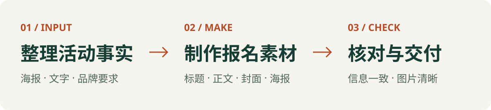

<div align="center">

# Event Listing Kit

### 一份活动资料，一套报名素材。

面向沙龙、工作坊与讲座的 Agent Skill。<br>
整理标题与文案，设计封面，修改海报，把活动信息讲清楚。

[快速开始](#快速开始) · [交付内容](#交付内容) · [高清修改](#已有海报也能继续改) · [使用边界](#使用前了解)

</div>



## 从这句话开始

附上活动海报或文字资料，然后告诉 Agent：

```text
使用 $event-listing-kit，为这场活动制作报名素材：
标题、150字以内的活动亮点、简介、完整详情和横版封面。
品牌和活动事实沿用原资料；缺失信息单独列出，不要补写。
```

不必每次制作整套。也可以只改标题、补活动亮点，或修改一张已有海报。

## 交付内容

| 文案，可直接复制 | 图片，按需制作 |
| :--- | :--- |
| **活动标题** — 品牌、期数与主题 | **横版封面** — 突出主题，适配报名展示 |
| **活动亮点** — 用于分享卡片的短文案 | **无二维码海报** — 去码后重新组织布局 |
| **简介与详情** — 内容、收获、人群与安排 | **局部预览** — 检查修改区域与排版 |

看看[文案字段示例](references/copy-example.md)：示例为虚构内容，仅展示组织方式。

## 快速开始

将完整仓库放入技能目录。Codex 默认目录可使用：

```bash
git clone https://github.com/Dvsx/event-listing-kit.git ~/.codex/skills/event-listing-kit
```

也可[下载 ZIP](https://github.com/Dvsx/event-listing-kit/archive/refs/heads/main.zip)，解压后将文件夹命名为 `event-listing-kit`，放入技能目录。请保留 `references/` 和 `agents/`；使用自定义 Codex 配置目录时，相应调整安装路径。

提供已有海报或活动资料，补充你的品牌要求，即可使用上面的示例请求。

## 已有海报，也能继续改

```text
使用 $event-listing-kit，把这张原始海报改成无二维码版。
保留人物和正文清晰度，重新排好底部信息，缩减多余留白。
交付完整图片，并注明实际像素尺寸。
```

**先保留细节，再调整布局。** 真人与密集中文海报优先考虑局部编辑，避免不必要的整图重绘。去掉二维码后，重新分组时间、地点、费用和名额，让信息框随内容收紧。

实际编辑方式取决于运行环境。技能会要求检查分辨率、文字与衔接处，不把简单放大当成高清恢复。详细方法见[海报编辑指南](references/poster-editing.md)。

## 按你的活动配置

- **品牌表达**：标题前缀、配色、字体与是否使用人物照，由本次资料决定。
- **内容范围**：只使用已确认的活动事实，缺失地址或退款条件单独备注。
- **素材规格**：150字亮点与16:9封面是准备参数，实际限制以目标平台为准。
- **发布节奏**：生成素材后由你决定是否发布，技能不会自动提交活动。

<details>
<summary><strong>仓库里有什么？</strong></summary>

| 文件 | 作用 |
| :--- | :--- |
| [SKILL.md](SKILL.md) | 制作流程、事实约束与交付标准 |
| [poster-editing.md](references/poster-editing.md) | 原图修改与布局检查 |
| [copy-example.md](references/copy-example.md) | 虚构文案示例 |
| [openai.yaml](agents/openai.yaml) | Codex 界面元数据 |

</details>

## 使用前了解

这是工作指导技能，**不附带图像模型、API密钥或自动修图程序**。生成和编辑图片需要运行环境提供相应工具；工具不可用时，可以先完成文案和设计说明。

请使用有权使用的品牌、人物与字体素材。仓库不包含真实客户资料或私人文件路径。
